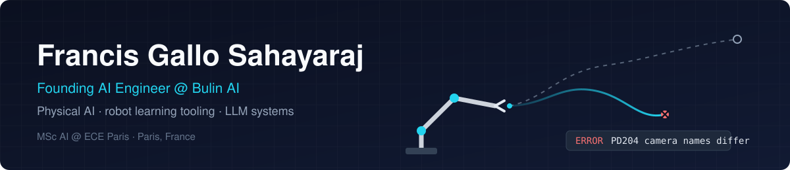
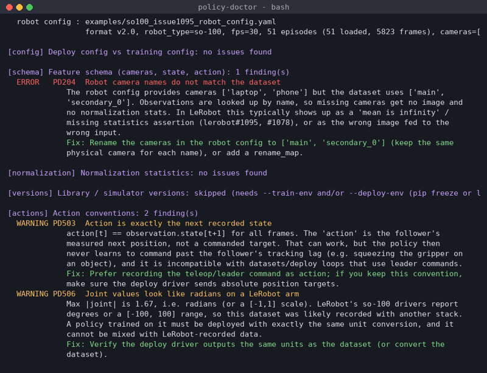

<!-- Profile README for github.com/Francis-Gallo (repo: Francis-Gallo/Francis-Gallo).
     Assets live in ./assets: banner.svg (3 KB), policy-doctor-still.png (~280 KB).
     Policy Doctor links to be added at launch. -->

<p align="center">
  
</p>

<p align="center">
  <a href="https://linkedin.com/in/francis-gallo-17877125a"></a>
  <a href="mailto:francisgallo2002@gmail.com"></a>
  <a href="https://francis-gallo.github.io/"></a>
</p>

I build tools that make learned robot policies easier to debug, and the LLM systems around them.
Right now I am a **Founding AI Engineer (intern) at Bulin AI** and finishing an
**MSc in Artificial Intelligence at ECE Paris** (2024–2026), based in Paris.

## 🩺 Featured: Policy Doctor

**Your policy works in training but fails on the robot. Why?**

**Policy Doctor** (launching soon) is an open-source, CPU-only CLI (plus a small
Gradio app) that compares a **LeRobot dataset**, a **trained checkpoint** and the **robot/deploy config**, and
explains the mismatches that most often break ACT, Diffusion Policy, SmolVLA, pi0/pi0.5, GR00T and openpi
deployments. Each finding has a code, a severity, the evidence and a concrete fix.



```bash
policy-doctor check me/my_dataset \
    --policy outputs/train/act_x/checkpoints/last/pretrained_model \
    --robot-config deploy.yaml
```

- **8 check groups, 82 finding codes:** config, schema, normalization, versions, actions, quality,
  GR00T/openpi framework checks, and opt-in video heuristics.
- **Light:** reads metadata, parquet and small JSON/safetensors files. No GPU, no model weights, no videos by default.
- **Tuned on real data:** 136 public LeRobot datasets and 17 dataset/checkpoint pairs. The heuristics and their
  limits are documented.
- **Reproduces a real bug:** in [lerobot#1095](https://github.com/huggingface/lerobot/issues/1095) it flags the
  camera-name mismatch behind a "mean is infinity" crash.

<p><b>Repo launching soon.</b></p>

## What I work on

| Area | What that looks like |
|---|---|
| **Physical AI / robot learning** | Pre-deployment checks for LeRobot policies: dataset ↔ checkpoint ↔ robot config, normalization stats, action conventions, camera setup |
| **LLM & RAG systems** | Text-to-SQL with schema retrieval, pgvector search, document Q&A, structured-output pipelines |
| **Local-first AI** | Apps that run on local models through LM Studio's OpenAI-compatible API |

## Other projects

| Project | What it is | Stack |
|---|---|---|
| [insightfusion-ai](https://github.com/Francis-Gallo/insightfusion-ai) | Ask a PostgreSQL database questions in plain English. The schema is retrieved from Qdrant, a local LLM writes the SQL, and the React UI picks a KPI card, chart or table | FastAPI · Qdrant · PostgreSQL · React/TS |
| [pulse-fashion-forecast](https://github.com/Francis-Gallo/pulse-fashion-forecast) | Collects Reddit, RSS and Google Trends signals and asks an LLM for 5 structured trend hypotheses | FastAPI · Groq / LM Studio · React |
| [rag-postgres](https://github.com/Francis-Gallo/rag-postgres) | A minimal RAG API on PostgreSQL + pgvector with local embeddings and generation | FastAPI · pgvector · LM Studio |
| [hybrid-ats-resume-analyzer](https://github.com/Francis-Gallo/hybrid-ats-resume-analyzer) | Scores a resume against a job description, section by section, with embeddings and local LLM feedback | Flask · LM Studio · pdfplumber |

<details>
<summary><b>Coursework and earlier data projects</b></summary>

- [GenerativeAI-RAG-QA-Bot](https://github.com/Francis-Gallo/GenerativeAI-RAG-QA-Bot): PDF question answering in a notebook (LangChain, Chroma, MiniLM, FLAN-T5, Gradio)
- [Machine-Learning-Project](https://github.com/Francis-Gallo/Machine-Learning-Project): road-accident fatality classification on French 2023 BAAC data (scikit-learn, SMOTE)
- [Telecom-churn-data](https://github.com/Francis-Gallo/Telecom-churn-data): churn EDA, SQL KPIs, Power BI and PySpark k-means on the IBM Telco dataset

</details>

## Toolbox


## Experience & education

- **Founding AI Engineer (intern), Bulin AI**: current
- **Automation & AI Engineer, Karma Com Solidarité**: previously. LLM document pipelines, RAG, n8n automation
- **MSc Artificial Intelligence, ECE Paris**: 2024–2026
- **B.E. Computer Science & Engineering, St. Xavier's College, India**: 2020–2024

## Get in touch

Working on robot learning, LeRobot deployments or evaluation tooling? I'd like to hear what breaks when
you deploy. [Message me on LinkedIn](https://linkedin.com/in/francis-gallo-17877125a) or
[email me](mailto:francisgallo2002@gmail.com).

<!-- Optional stats card. Add it once Policy Doctor has some stars; with few stars it hurts more than it helps.
     The public vercel instance is often rate-limited, so self-host github-readme-stats or use a GitHub Action that commits an SVG.

-->
